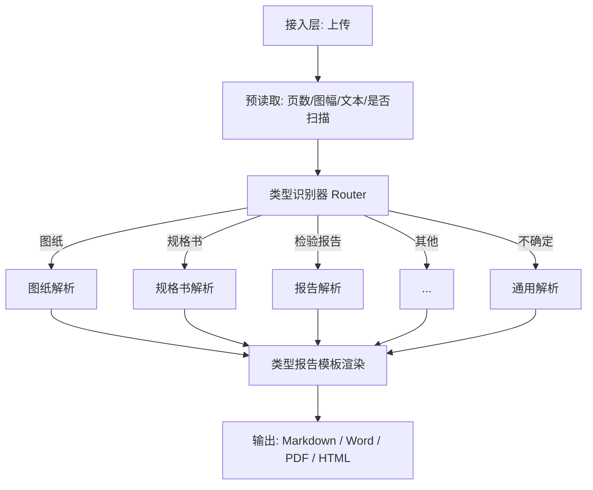

# 智能 PDF 解析智能体 — 设计文档

> 版本：v0.4（修订）
> 日期：2026-10-17
> 状态：待评审

## 1. 项目概述

### 1.1 一句话定位

上传任意 PDF，AI 先自动识别文档类型（工程图纸、规格书、检验报告、BOM、合同、手册等），再按该类型对应的解析策略提取重点内容，输出一份**给人看的**结构化报告（例如图纸 → 图纸识别报告）。

### 1.2 核心目标

- 自动识别类型：用户不用告诉系统“这是什么文档”。
- 类型化解析：每种类型有专属的提取重点和输出模板。
- 忠于原文：不编造，拿不准的内容标“未提及/待补充”，并尽量给页码/图面定位。
- 样例驱动：以真实样例定义每一类的输入特征与输出标准。

### 1.3 非目标

- 不做机器读的结构化入库/对接 ERP（远期可选项）。
- 不做逐字版式复刻。
- 不做实时控制类集成。

## 2. 参考样例（本项目的第一类）

### 2.1 输入样例

一张 **A0 工程图纸（CAD 导出 PDF，矢量 + 中文字体）**，单页，包含：

- 标题栏：名称、编码、材料、重量、比例、图幅、页码（如“第 1 页 共 7 页”）。
- 明细表（BOM）：序号 / 编码 / 描述 / 版本 / 数量 / 单位。
- 基准表：基准面 A/B/C 及其参考基准、所在页。
- 尺寸标注：孔径、壁厚、公差、圆角、顶针高度等。
- 技术要求：分“拉胀堵头 / 绝缘膜 / 箱体”等多组编号条款。
- 引用标准：GB/T、企业 SIT 标准等。

### 2.2 目标输出样例

一份 **A4 图纸识别报告**，结构为：

- 头部：来源文件、名称、编码、重量、比例、整理日期。
- 范围限制：如实说明“源 PDF 仅 1 页，标题栏写共 7 页”等。
- 一、尺寸及公差（表格：项目 / 图纸标注）。
- 二、材料及组成（表格：部件编码 / 名称材料 / 数量）。
- 三、工艺及检验要求（分主题要点）。
- 四、待补充确认（缺页、缺 3D、标准正文未随文件提供等）。

这份样例证明了本项目的核心模式：**先分类，再按类型套用“提取要点 + 报告模板”**。

## 3. 文档类型注册表

每种类型定义四件事：识别特征、解析重点、输出模板、所需样例。

| 类型 | 识别特征 | 解析重点 | 输出模板 |
|---|---|---|---|
| 工程图纸 drawing | 大图幅（A0–A4）、标题栏、明细表、基准表、尺寸标注、技术要求 | 标题栏信息、尺寸与公差、材料/明细、工艺与检验、引用标准 | 图纸识别报告 |
| 技术规格书 spec | 章节化、参数表、适用范围、性能指标 | 核心参数表、适用范围、性能/验收条件 | 规格要点报告 |
| 检验/检测报告 report | 检验项目表、判定结果、签名/盖章 | 检验项目与结果、结论、异常项 | 检验结论报告 |
| BOM 清单 bom | 以表格为主，列：编码/名称/数量/材质 | 物料明细、汇总数量、材质统计 | 物料清单摘要 |
| 合同/协议 contract | 条款编号、甲乙方、金额、期限 | 关键条款、金额、期限、违约责任 | 关键条款提取 |
| 手册/说明书 manual | 长文档、章节多、含安全警示 | 操作要点、安全注意事项、参数 | 手册要点报告 |
| 通用文档 generic | 无以上特征 | 摘要、要点、关键数据、结论 | 通用重点报告 |

注册表可扩展：新增类型只需补充“识别特征 + 输出模板 + 样例”，不动主流水线。

## 4. 整体架构



主流水线（识别后进入同一套“提取引擎”，只是换了模板与提示词）：


## 5. 类型识别设计

采用“规则初筛 + 大模型终判 + 置信度兜底”三级：

1. 规则初筛（快、零成本）：页数、页面尺寸（A0–A4）、是否有标题栏/明细表/表格/印章、文本密度、是否扫描件。
2. 大模型终判：把首页（必要时 + 文本摘要）交给 LLM/VLM，从注册表里选最匹配的类型，并给出理由。
3. 兜底：置信度低于阈值或类型不在注册表时，降级为 `generic` 通用解析，并在报告里注明。

识别结果结构：

```json
{
  "doc_type": "drawing",
  "confidence": 0.96,
  "evidence": ["A0 图幅", "存在标题栏", "存在明细表", "存在技术要求"],
  "routing": "drawing_pipeline"
}
```

## 6. 图纸类型的详细解析设计（重点）

图纸是最难、也最有代表性的类型。输入是 CAD 矢量 PDF，文字坐标零散、阅读顺序混乱、BOM 表格列交错，**纯文本抽取不够，必须结合高分辨率渲染图 + 视觉模型**。

### 6.1 读取

- 高分辨率渲染整页为图片（A0 大图可切片或降采样到模型可处理范围）。
- 同时做文本抽取（pdfplumber/PyMuPDF），用于定位关键词与表格。
- 识别图幅、标题栏、明细表、技术要求、基准表等区域。

### 6.2 提取项（对应报告四段）

1. 头部信息：名称、编码、材料、重量、比例、图幅、页码、修订记录。
2. 尺寸及公差：孔径、壁厚、圆角、顶针高度、未注公差标准、螺纹精度等。
3. 材料及组成：从明细表重建 BOM 表格（编码/名称/材质/数量/单位/版本）。
4. 工艺及检验：技术要求按“堵头/绝缘膜/箱体”等主题归组，抽取装配、密封、清洁、环保、追溯等要求，并保留引用标准编号。
5. 待补充确认：缺页、缺 3D 数据、标准正文未随文件提供、图面矛盾点。

### 6.3 关键规则（写进提示词）

- 只依据图面内容，禁止编造尺寸与材料。
- 明细表必须逐行还原，材质“/”或未注明时如实写“未注明”。
- 技术要求的每条要求保留标准编号（如 SIT0045004、GB/T 1804-2008）。
- 图纸标注“第 X 页 共 Y 页”与实际页数不符时，必须在报告里说明范围限制。

## 7. 输出报告模板（图纸）

```markdown
# 图纸识别报告

来源文件：xxx.pdf ｜ 名称：XXX ｜ 编码：XXXX ｜ 重量：6.06 kg ｜ 比例：1:2

范围限制：源 PDF 仅含 1 页，标题栏标注“第 1 页，共 7 页”……

## 一、尺寸及公差
| 项目 | 图纸标注 |
| --- | --- |
| 吊耳孔 | 直径 12，3 处 |

## 二、材料及组成
| 部件编码 | 名称 / 材料 | 数量 |
| --- | --- | --- |
| SIT20201766 | CSP_箱体零件 / AlSi12Fe | 1 |

## 三、工艺及检验要求
- 箱体压铸：按《SIT0045004》执行……

## 四、待补充确认
1. 补齐其余页及 3D 数据……
```

## 8. 技术选型

| 模块 | 首选 | 说明 |
|---|---|---|
| 文本抽取 | pdfplumber / PyMuPDF | 图纸文字坐标、表格辅助 |
| 页面渲染 | pdftoppm / PyMuPDF | 大图高分辨率渲染 |
| 视觉理解 | GPT-4o / Gemini / Qwen2.5-VL | 图纸阅读顺序与图面理解的关键 |
| 类型识别 | 规则 + LLM | 三级识别 |
| 编排 | LangGraph | 类型路由与流水线状态 |
| 后端 | FastAPI | 上传 + 任务查询 |
| 任务队列 | Redis + RQ/Celery | 大图异步处理 |
| 报告生成 | ReportLab / pandoc / python-docx | 输出 PDF/Word（样例报告即 ReportLab 生成） |
| OCR 兜底 | PaddleOCR | 扫描件图纸 |

## 9. 前后端接口契约（前端联调依据）

本文档是前端与后端联调的唯一依据。前端只通过下列 HTTP 接口与后端交互，不直接访问文件系统或数据库。

### 9.1 通用约定

- Base URL：`http://<host>:8000`（前端在 `CONFIG.API_BASE` 配置）。
- 编码：UTF-8；JSON 字段命名统一用 snake_case。
- 文件上传：`multipart/form-data`，字段 `file` 为 PDF 二进制，`options` 为 JSON 字符串。
- 除上传与下载外，请求与响应均为 `application/json`。
- 轮询间隔建议 1.5s；单任务超时建议 5 分钟。

### 9.2 枚举定义

| 枚举 | 值 | 说明 |
|---|---|---|
| doc_type | drawing / spec / report / bom / contract / manual / generic | 文档类型 |
| format | markdown / pdf / docx / html | 报告输出格式 |
| status | queued / running / success / failed | 任务状态 |

前端显示用中文标签映射：drawing=工程图纸、spec=技术规格书、report=检验/检测报告、bom=BOM 物料清单、contract=合同/协议、manual=手册/说明书、generic=通用文档。

### 9.3 接口总览

| 方法 | 路径 | 用途 |
|---|---|---|
| POST | /v1/parse | 提交解析任务 |
| GET | /v1/parse/{job_id} | 查询任务状态与结果 |
| GET | /v1/parse/{job_id}/download?format=pdf | 下载转换后的报告文件 |
| GET | /health | 健康检查 |

### 9.4 提交解析任务

```
POST /v1/parse
Content-Type: multipart/form-data

file: <pdf 二进制>
options: {"mode": "auto", "doc_type": null, "format": "markdown"}
```

options 字段：

| 字段 | 类型 | 必填 | 说明 |
|---|---|---|---|
| mode | string | 是 | auto=自动识别类型；manual=按 doc_type 解析 |
| doc_type | string 或 null | manual 时必填 | 见 9.2 枚举；auto 时可传 null |
| format | string | 否 | 默认 markdown |

成功响应（HTTP 202）：

```json
{"job_id": "job_abc123", "status": "queued"}
```

校验失败（HTTP 400）：

```json
{"error": {"code": "invalid_options", "message": "doc_type 取值非法"}}
```

### 9.5 查询任务

```
GET /v1/parse/{job_id}
```

排队或处理中（HTTP 200）：

```json
{"job_id": "job_abc123", "status": "running"}
```

成功（HTTP 200）：

```json
{
  "job_id": "job_abc123",
  "status": "success",
  "doc_type": "drawing",
  "confidence": 0.96,
  "pages": 1,
  "report": "# 图纸识别报告\n\n## 一、尺寸及公差\n...",
  "format": "markdown",
  "download_url": null
}
```

失败（HTTP 200，status=failed）：

```json
{
  "job_id": "job_abc123",
  "status": "failed",
  "error": {"code": "parse_failed", "message": "第 1 页解析失败"}
}
```

成功响应字段：

| 字段 | 类型 | 说明 |
|---|---|---|
| doc_type | string | 识别出的文档类型；前端按 9.2 映射为中文标签 |
| confidence | number 或 null | 0~1；auto 模式给出，manual 模式可为 null |
| pages | number 或 null | 源文件页数 |
| report | string | Markdown 文本，前端直接渲染 |
| format | string | 用户请求的输出格式 |
| download_url | string 或 null | 请求非 markdown 格式时返回转换文件地址 |

### 9.6 下载报告

```
GET /v1/parse/{job_id}/download?format=pdf
```

- 仅当任务 status=success 且 format 非 markdown 时有效。
- 响应：二进制文件，`Content-Disposition: attachment; filename="xxx_解析报告.pdf"`。
- format 不合法返回 HTTP 400，文件不存在返回 HTTP 404。

### 9.7 错误码

| HTTP | code | 说明 |
|---|---|---|
| 400 | file_missing | 未上传文件 |
| 400 | invalid_file_type | 非 PDF 文件 |
| 400 | file_too_large | 超过 50 MB |
| 400 | invalid_options | options 参数非法 |
| 404 | job_not_found | job_id 不存在 |
| 500 | parse_failed | 解析失败 |
| 503 | model_unavailable | 模型服务不可用 |

错误统一信封：

```json
{"error": {"code": "parse_failed", "message": "人类可读描述"}}
```

### 9.8 前端联调约定

- 状态到步骤映射：queued=上传文件；running=识别类型/解析内容；success=生成报告完成；failed=解析失败。
- `report` 是 Markdown，前端渲染为 HTML（标题、表格、列表、加粗、链接）。
- 下载：format=markdown 时前端直接用 `report` 生成 .md；其他格式走 9.6 下载接口。
- 轮询：GET 接口 1.5s 一次，拿到 success 或 failed 后停止；超过 5 分钟提示超时。
- 同一任务只提交一次，之后只轮询，不重复提交。

## 10. 评估体系

金标准集：每种类型准备 10–20 份真实文档，人工标注“必须提取的关键点”，图纸类以样例报告为基准。

指标：

- 类型识别准确率：分类正确的比例。
- 关键信息覆盖率：报告覆盖人工标注要点的比例。
- 忠实度：报告中是否有原文没有的内容（幻觉率，目标趋近 0）。
- 表格还原准确率：BOM 等表格的行列是否正确。

## 11. 里程碑

| 阶段 | 时间 | 交付物 |
|---|---|---|
| M0 图纸原型 | 第 1 周 | 单张图纸 → 图纸识别报告（尺寸/材料/工艺/待确认） |
| M1 类型识别 | 第 2 周 | 自动识别图纸/规格书/报告/BOM/通用，路由到对应流水线 |
| M2 类型扩展 | 第 3–4 周 | 补齐 2–3 类报告模板，支持扫描件 OCR 兜底 |
| M3 工程化 | 第 5–6 周 | 异步队列、批量、多格式导出、评估集回归、部署 |

## 12. 风险与应对

| 风险 | 影响 | 应对 |
|---|---|---|
| 图纸文字坐标零散、阅读顺序乱 | 提取错位 | 视觉模型 + 文本双路，区域定位优先 |
| 明细表列交错 | BOM 错行 | 表格结构识别 + 逐行校验 |
| 图面尺寸/材料幻觉 | 工程上致命 | 强约束 + 原图定位 + 待确认兜底 |
| 大图超长/超尺寸 | 模型上下文或分辨率超限 | 切片、降采样、按区域提取 |
| 类型误判 | 走错模板 | 三级识别 + 置信度 + 通用兜底 |
| 缺页/缺 3D 数据 | 报告不完整 | 报告固定“范围限制 + 待补充确认”段 |

## 13. 附录：参考项目

- gptpdf：https://github.com/CosmosShadow/gptpdf
- PaddleOCR：https://github.com/PaddlePaddle/PaddleOCR
- RAGFlow：https://github.com/infiniflow/ragflow
- Docling：https://github.com/docling-project/docling
- olmOCR：https://github.com/allenai/olmocr
